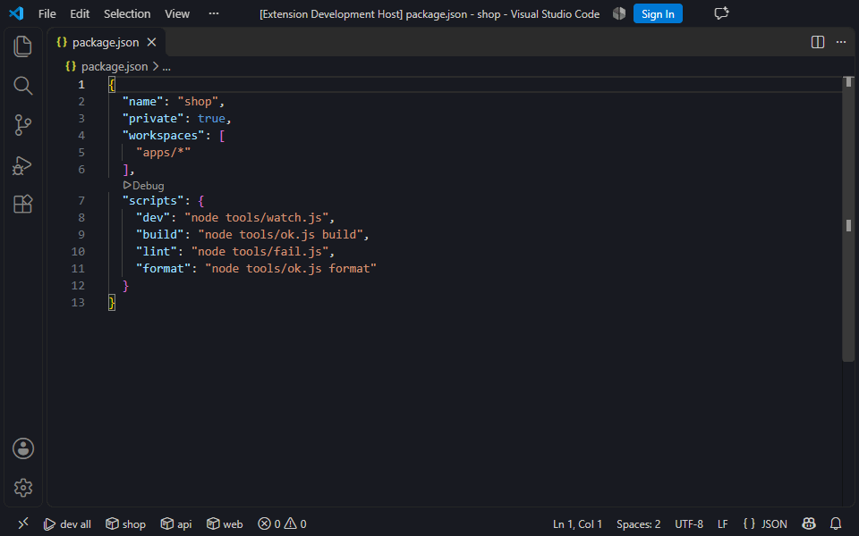
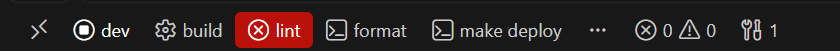
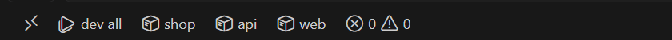
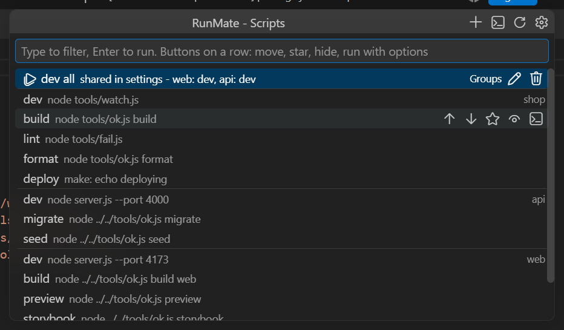
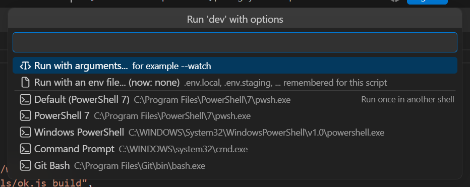
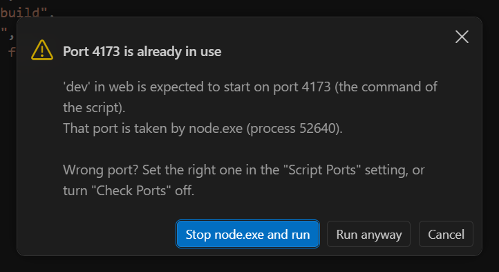
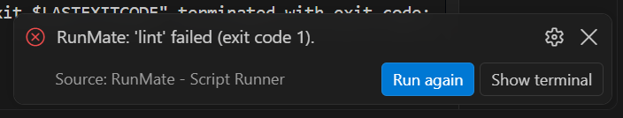
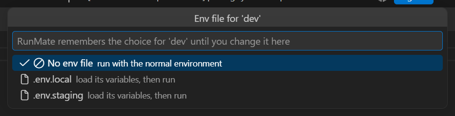

# RunMate - Script Runner

**Run your project's scripts with one click, from the bar at the bottom of VS Code.**

Every project has commands you type again and again: `npm run dev`, `pnpm build`, `make test`. RunMate reads those commands from your project and turns them into buttons. You click a button, the command runs in the terminal. That is the whole idea.

It also takes care of the boring parts for you:

- it knows whether to use **npm, pnpm, Yarn or Bun**
- it runs the command in the **right folder**, also in repositories with several projects inside
- it switches to the **Node.js version** the project asks for
- if something is **not installed**, it tells you and offers to install it
- if the **port is taken** by an old server, it tells you who holds it and offers to stop it
- if a script **fails**, its button turns red and you can run it again with one click



## Contents

- [Install](#install)
- [First steps](#first-steps)
- [What the buttons mean](#what-the-buttons-mean)
- [The script list](#the-script-list)
- [How do I...](#how-do-i)
- [When the port is already taken](#when-the-port-is-already-taken)
- [When a script fails](#when-a-script-fails)
- [Env files](#env-files)
- [Groups, and sharing them with your team](#groups-and-sharing-them-with-your-team)
- [Repositories with several projects](#repositories-with-several-projects)
- [Deno, Makefile and just](#deno-makefile-and-just)
- [Node.js versions](#nodejs-versions)
- [Package managers](#package-managers)
- [Settings](#settings)
- [Commands and shortcuts](#commands-and-shortcuts)
- [Problems and answers](#problems-and-answers)

## Install

1. Open VS Code.
2. Open the Extensions view (`Ctrl+Shift+X`, on Mac `Cmd+Shift+X`).
3. Search for **RunMate - Script Runner** and click **Install**.

Needs VS Code 1.75 or newer. Works on Windows, macOS and Linux, also in WSL and remote windows.

## First steps

1. Open a folder that contains a `package.json` (**File > Open Folder**).
2. Look at the bottom-left corner of the window. You will see buttons such as `dev`, `build`, `start`.
3. Click `dev`. A terminal opens and your script runs.
4. The button now shows a stop sign. Click it again to stop the script.

Nothing to configure. If you see no buttons, read [Problems and answers](#problems-and-answers).

Prefer a guided tour? `Ctrl+Shift+P`, then **RunMate: Open the Getting Started Guide**.

## What the buttons mean

One project: a button for each script.



Several projects: a button for each project, and for each group you made.



| You see | What it is | What a click does |
|---------|------------|-------------------|
| `▶ dev`, `⚙ build`, `🚀 start` | A script | Runs it |
| `⏹ dev` (orange) | A script that is running | Stops it |
| `✖ lint` (red) | A script that failed | Runs it again |
| `📦 web` | A project (when your repository has several) | Shows the scripts of that project |
| `🔄 web` (orange) | A project with a running script | Shows its scripts; running ones have a stop button |
| `▶▶ dev all` | A group you made | Starts all its scripts |
| `...` or `... +5` | The script list | Opens the list with every script and the settings. `+5` means five more scripts have no button of their own |

## The script list

The list shows everything RunMate found. Open it in any of these ways:

- press `Ctrl+Alt+Q`
- click the `...` button in the status bar
- click a project button

Type to filter, press `Enter` to run.



**Buttons on each row** (they appear when you point at a row):

| Button | What it does |
|--------|--------------|
| ↑ ↓ | Moves the script up or down. The status bar uses the same order. |
| ☆ | Makes it a favorite. Favorites are listed first and get the first status bar buttons. |
| 👁 | Hides the script. It moves to a **Hidden** section at the bottom of the list. Click the eye there to bring it back. |
| Terminal | **Run with options**: run with extra arguments, with an env file, or once in a different shell. |
| ⏹ | Only while the script runs: stops it. |

A row also tells you what is going on: a spinning icon while the script runs, a red cross and `failed, exit code 1` after it failed, and `env: .env.staging` when it runs with an env file.

**Buttons at the top of the list:**

| Button | What it does |
|--------|--------------|
| + | Makes a group: several scripts that start with one click. |
| Terminal | Chooses the shell RunMate uses for all scripts. |
| ⟳ | Looks for projects and scripts again. |
| ⚙ | Opens RunMate's settings menu (number of buttons, layout, and more). |

## How do I...

**...run a script?** Click its button, or open the list and press `Enter` on it.

**...stop a script?** Click its button again (it shows a stop sign while running). To stop everything: `Ctrl+Shift+P`, then **RunMate: Stop Running Scripts**.

**...run a script with extra arguments?** Open the list, click the terminal button on the row, choose **Run with arguments...** and type them, for example `--watch`. RunMate remembers the last five per script and offers them next time.



**...run a script with another env file?** Same terminal button on the row, then **Run with an env file...** and pick the file. See [Env files](#env-files).

**...run a script in a different shell just once?** Same terminal button on the row, then pick the shell (for example Git Bash).

**...run the same script again quickly?** `Ctrl+Shift+P`, then **RunMate: Run Last Script Again**. It repeats the last run with the same arguments and shell. You can give this command your own keyboard shortcut.

**...start several scripts at once?** Make a group. In the list click **+**, tick the scripts (for example `dev` of `web` and `dev` of `api`), give the group a name. A button with that name appears in the status bar. One click starts them all, another click stops them all.

**...give my team the same group button?** Click the people icon on the group's row. See [Groups, and sharing them with your team](#groups-and-sharing-them-with-your-team).

**...free a port that an old server still holds?** Just run the script. RunMate notices and offers to stop the old server. See [When the port is already taken](#when-the-port-is-already-taken).

**...show fewer buttons?** Open the list, click ⚙, choose **Script buttons shown** and enter a number.

**...get rid of a script I never use?** Open the list and click the eye on its row.

**...change the order?** Open the list and use the arrows on a row.

## When the port is already taken

You click `dev`, and an old server is still sitting on the port. Normally you get a confusing error, or the new server quietly moves to another port and you keep looking at the old page.

RunMate checks the port **before** it starts the script:



- **Stop ... and run** stops the program that holds the port, then starts your script.
- **Run anyway** starts your script without touching anything.
- **Cancel** does nothing.

How does RunMate know the port?

1. From the script or the arguments: `--port 3000`, `-p 3000` or `PORT=3000`.
2. From `PORT` in the env file the script runs with.
3. From the usual port of the tool: Vite 5173, Next.js and Nuxt 3000, Angular 4200, Astro 4321, Storybook 6006, webpack dev server 8080, Gatsby 8000, Expo 8081.
4. From you: if RunMate cannot know (for example `node server.js`), tell it in the **Script Ports** setting: `{ "dev": 8080 }`.

If RunMate does not know the port, it checks nothing and the script just runs. To switch the check off, turn **Check Ports** off.

## When a script fails

When a script stops with an error:

- its button turns **red**, so you see it even if the terminal is hidden
- a message appears with **Run again** and **Show terminal**



The red mark goes away when you run the script again. Stopping a script yourself (the stop button, or `Ctrl+C` in the terminal) is not a failure and is not reported.

Do not want the message? Turn **Notify On Failure** off. The red button stays.

## Env files

An env file is a file such as `.env.local` or `.env.staging` with lines like `API_URL=https://staging.example.com`. RunMate can load one before a script starts, so the same `dev` script can run against local, staging or anything else.

**For one script:** open the list, click the terminal button on the row, choose **Run with an env file...** and pick a file.



RunMate remembers the choice for that script. The row then shows `env: .env.staging`, and every run of that script uses it, also from the status bar button. To go back, choose **No env file** in the same place.

**For all scripts:** set **Env File** to a file name, for example `.env.local`. Projects that do not have this file run as usual. A choice made for one script wins over this setting.

Good to know:

- RunMate looks for env files in the project folder and in the workspace folder. Files that are only examples (`.env.example`, `.env.sample`, `.env.template`) are not offered.
- The variables are set in the terminal before the script starts. For most tools (Vite, Next.js, dotenv) this means they win over the values in the tool's own `.env`.
- If the chosen file is deleted, RunMate tells you instead of quietly running without it.
- References to other variables (`${OTHER}`) inside the file are not filled in.

## Groups, and sharing them with your team

A group is one button that starts several scripts.

1. Open the list and click **+**.
2. Tick the scripts, for example `dev` of `web` and `dev` of `api`.
3. Name the group, for example `dev all`.

A group you make like this is yours alone. To give it to the whole team, click the **people icon** on the group's row. RunMate moves it into `.vscode/settings.json` of the repository:

```json
{
  "run-mate-script-runner.groups": [
    {
      "name": "dev all",
      "scripts": [
        { "path": "apps/web", "script": "dev" },
        { "path": "apps/api", "script": "dev" }
      ]
    }
  ]
}
```

Commit that file. Everyone who uses RunMate in this repository now has the `dev all` button. In the list such a group is marked `shared in settings`; the pencil and the bin on its row change the settings file for you.

Writing it by hand works too. `path` is the folder of the project (leave it out for the root project, or write just `"dev"`). For other sources put the kind in front: `"make:build"`, `"just:up"`, `"deno:start"`.

## Repositories with several projects

Some repositories contain more than one project, for example:

```
my-app/
  package.json
  apps/
    web/package.json
    api/package.json
```

RunMate finds all of them. Instead of one long row of scripts you get **one button per project**: `my-app`, `web`, `api`. Click `web` to see only the scripts of `web`. They run from the `apps/web` folder, with the package manager and Node version of that project.

RunMate finds projects in two ways:

1. It reads what the repository itself declares: `workspaces` in `package.json` (npm, Yarn, Bun) and `packages` in `pnpm-workspace.yaml`. These are found however deep they are.
2. It also looks through subfolders, three levels deep by default. Folders such as `node_modules`, `dist` and `build` are skipped.

If you prefer the old single row of script buttons, set **Status Bar Layout** to `scripts`. To stop looking into subfolders, turn **Nested Projects** off.

## Deno, Makefile and just

RunMate is not only for `package.json`. It also shows:

| File | What RunMate shows | How it runs |
|------|-------------------|-------------|
| `deno.json`, `deno.jsonc` | the `tasks` | `deno task <name>` |
| `Makefile` | the targets | `make <name>` |
| `justfile` | the recipes | `just <name>` |

These appear in the same list. Their buttons are labelled with the tool, for example `make build`, so you can tell them apart from a `build` script in `package.json`.

Do not want them? Remove them in **Script Sources** (in the list: ⚙, then **Sources**).

## Node.js versions

A project can say which Node.js version it needs. RunMate reads these, in this order:

1. `.nvmrc`
2. `.node-version`
3. `.tool-versions` (the `nodejs` line)
4. `volta.node` in `package.json`
5. `engines.node` in `package.json` (a range such as `>=20`)

RunMate looks in the project folder first and then in the folders above it, so a project inside a bigger repository uses the version file at the top.

Then, each time you run a script:

| Situation | What RunMate does |
|-----------|-------------------|
| The Node you have active already fits | Nothing. The script just runs. |
| A different version is needed, and it is installed | Switches to it for this run. |
| The version is not installed | Asks: **Install Node X and run**, or run with the current Node. |
| No version manager is installed at all | Offers to install **fnm**, and shows the exact command first. |

RunMate works with **nvm**, **nvm for Windows**, **fnm** and **Volta**. You do not have to set them up for RunMate; it finds them.

It never installs anything without asking you.

## Package managers

RunMate picks the package manager like this:

1. The `packageManager` field in `package.json`, if there is one (`"packageManager": "pnpm@9.0.0"`).
2. Otherwise the lockfile: `pnpm-lock.yaml` means pnpm, `yarn.lock` means Yarn, `bun.lock` means Bun, `package-lock.json` means npm.
3. If nothing is found: npm.

For a project inside a bigger repository, RunMate also looks at the folders above it, because the lockfile is usually at the top.

If the package manager is not installed, RunMate offers to install it (`npm install -g pnpm`, for example) before running the script.

If the dependencies are not installed yet (no `node_modules` folder), RunMate runs the install command first.

## Settings

The quickest way: open the script list and click ⚙. The most used settings are there.

All settings are also in VS Code's Settings (`Ctrl+,`), search for **RunMate**. In `settings.json` every name starts with `run-mate-script-runner.`

### What you see in the status bar

| Setting | Default | In plain words |
|---------|---------|----------------|
| `statusBarLayout` | `auto` | What the buttons are. `auto` decides for you: one project gives script buttons, several projects give project buttons. `scripts` always shows script buttons. `projects` always shows project buttons. `picker` shows a single **Scripts** button. |
| `maxDynamicScriptButtons` | `8` | How many scripts get their own button. The rest are behind `...`. `0` shows only `...`. |
| `maxProjectButtons` | `4` | How many projects get their own button. |
| `statusBarSide` | `left` | Left or right end of the status bar. |
| `useDynamicScriptParsing` | `true` | Turn off to hide all RunMate buttons. `Ctrl+Alt+Q` still works. |

### What RunMate looks for

| Setting | Default | In plain words |
|---------|---------|----------------|
| `nestedProjects` | `true` | Also find projects in subfolders. |
| `nestedProjectsMaxDepth` | `3` | How many folder levels down to look. `apps/web` is 2 levels. |
| `nestedProjectsExclude` | `node_modules`, `dist`, ... | Folder names that are never searched. |
| `scriptSources` | `npm`, `deno`, `make`, `just` | Which kinds of scripts to show. Remove one to hide it. |
| `excludeScripts` | `test`, `postinstall`, `preinstall` | Script names to ignore completely. |
| `scriptOrder` | `dev`, `start`, `build`, `test`, `lint` | Which scripts come first. Your own order (the arrows in the list) wins over this. |
| `workspaceMode` | `first` | Only when several folders are open in one window. `first`: only the first folder. `all`: every folder. `pick`: every folder, and ask which project when several have the same script. |

### How scripts run

| Setting | Default | In plain words |
|---------|---------|----------------|
| `shell` | `default` | Which shell runs the scripts. `default` is the same as a new VS Code terminal. Others: `pwsh`, `powershell`, `cmd`, `gitbash`, `bash`, `zsh`, `fish`, `sh`. |
| `nodeVersionManager` | `auto` | Which tool switches Node versions: `auto`, `nvm`, `fnm`, `volta`, or `none` to never switch. |
| `preflightChecks` | `true` | Before a run, offer to install what is missing. Turn off to never be asked. |
| `autoInstallMissingDependencies` | `true` | Run install first when `node_modules` is missing. |
| `alwaysInstallDependencies` | `false` | Run install before every script. |
| `reuseTerminalForScripts` | `true` | Reuse one terminal tab per script instead of opening a new one each time. |
| `askBeforeKill` | `true` | When you start a script that is already running, ask whether to restart or stop it. |
| `envFile` | empty | An env file loaded for every script, for example `.env.local`. See [Env files](#env-files). |

### Help when something goes wrong

| Setting | Default | In plain words |
|---------|---------|----------------|
| `checkPorts` | `true` | Before a run, check that the port of the dev server is free, and offer to stop the program that holds it. |
| `scriptPorts` | `{}` | Tell RunMate the port of a script it cannot work out: `{ "dev": 8080 }`. |
| `notifyOnFailure` | `true` | Show a message with **Run again** when a script fails. |

### Shared with your team

| Setting | Default | In plain words |
|---------|---------|----------------|
| `groups` | `[]` | Groups of scripts for everyone in the repository. See [Groups, and sharing them with your team](#groups-and-sharing-them-with-your-team). |

### Example

To share settings with your team, put them in `.vscode/settings.json` in the repository:

```json
{
  "run-mate-script-runner.statusBarLayout": "projects",
  "run-mate-script-runner.shell": "gitbash",
  "run-mate-script-runner.maxDynamicScriptButtons": 5,
  "run-mate-script-runner.scriptSources": ["npm"]
}
```

### What RunMate remembers by itself

Favorites, hidden scripts, your order, your own groups, recent arguments and the env file chosen for a script are saved **per workspace**. What you arrange in one repository does not change another.

## Commands and shortcuts

Open the Command Palette with `Ctrl+Shift+P` (Mac: `Cmd+Shift+P`) and type **RunMate**.

| Command | Shortcut | What it does |
|---------|----------|--------------|
| RunMate: Show All Scripts | `Ctrl+Alt+Q` | Opens the script list |
| RunMate: Run Last Script Again | none | Repeats the last run |
| RunMate: New Group | none | Makes a group of scripts that start together |
| RunMate: Stop Running Scripts | none | Stops everything RunMate started |
| RunMate: Open the Getting Started Guide | none | A short tour of RunMate inside VS Code |

To add your own shortcut: `Ctrl+K Ctrl+S`, search for the command, click the pencil.

## Problems and answers

**I see no buttons.**
Check these in order: Is a folder open (not just a file)? Does it have a `package.json` with a `scripts` section? Is the script in the **Hidden** section of the list, or in `excludeScripts`? Is `useDynamicScriptParsing` on?

**A script is missing.**
`test`, `postinstall` and `preinstall` are excluded by default. Remove `test` from `excludeScripts` if you want it.

**RunMate uses the wrong package manager.**
Add the `packageManager` field to `package.json`, for example `"packageManager": "pnpm@9.0.0"`.

**I installed something, but RunMate still says it is missing.**
Close VS Code completely and open it again. A running VS Code does not notice newly installed programs.

**A folder shows up as a project and should not.**
Add its name to `nestedProjectsExclude`.

**A project is not found.**
It may be deeper than three folders. Raise `nestedProjectsMaxDepth`, or list it in `workspaces` in the root `package.json`.

**On Windows, nvm asks for administrator permission.**
`nvm use` changes a system-wide setting and Windows may ask for permission. RunMate only calls it when the active Node is not the one the project needs.

**A script works in my terminal but not from RunMate.**
Your terminal may be a different shell. Open the list, click the terminal button on the row and try another shell, or set `shell`.

**RunMate says a port is taken, but my script uses another port.**
RunMate guessed from the tool's usual port. Tell it the real one in `scriptPorts`, for example `{ "dev": 8080 }`, or turn `checkPorts` off.

**My server moved to another port and RunMate said nothing.**
RunMate did not know the port. Put it in `scriptPorts`.

**A button stays red.**
That script failed the last time it ran. Run it again; the mark goes away when it starts.

**My script does not see the variables of the env file.**
Check that the row in the list shows `env: <your file>`. If your tool reads its own `.env` with an "override" option, its values win over RunMate's.

**Does RunMate send any data anywhere?**
No. It reads files in your workspace and runs commands in your terminal. It installs software, and stops other programs, only after you confirm.

## For contributors

```
npm test           # logic, plus generated commands run in every installed shell
npm run test:host  # the extension inside a throwaway VS Code window
npm run test:linux # all of it on Linux in Docker, with real Node installs
npm run shots      # retake the pictures of this README from a real VS Code window
```

All tests run on your own machine; there is no CI.

Found a bug or have an idea? [Open an issue](https://github.com/SanekxArcs/my-vscode-extention/issues).

## License

MIT
