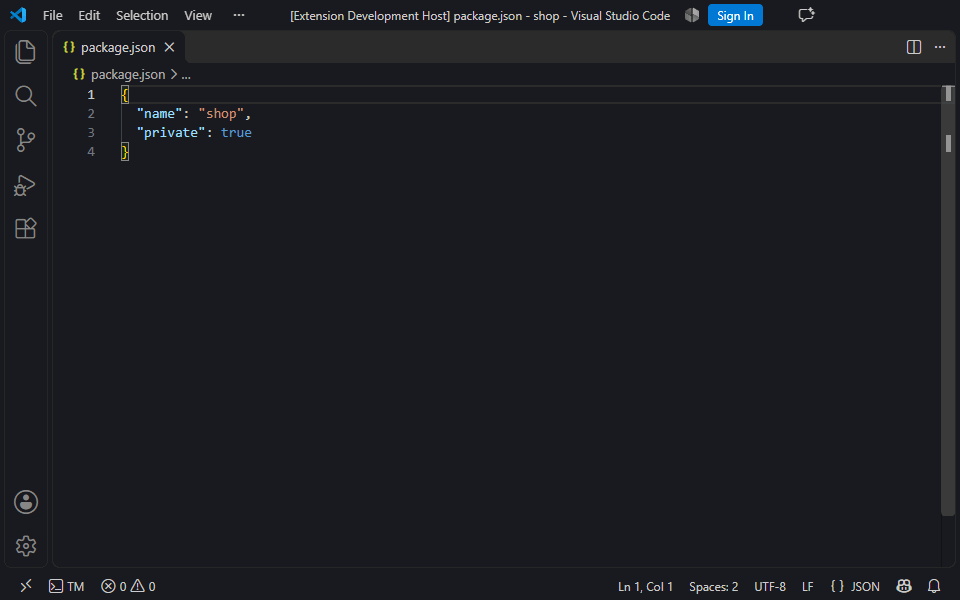
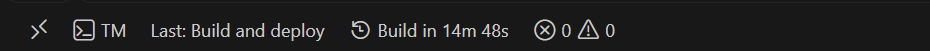
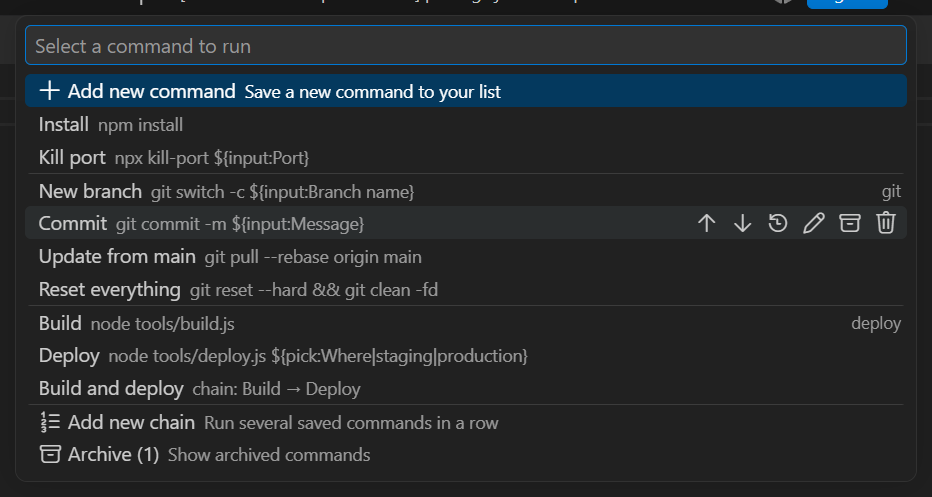
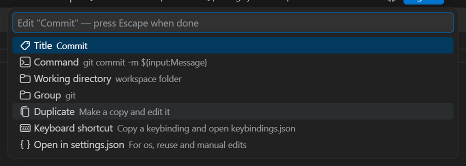
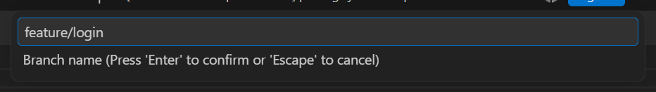
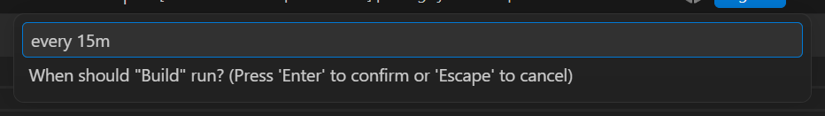
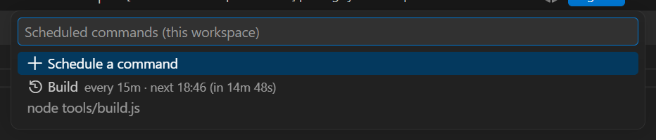
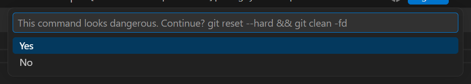

# TerminalMate

**Save the terminal commands you type again and again, and run them with one click.**

Everyone has commands they type every day: `git pull --rebase origin main`, `npx kill-port 3000`, a long deploy line nobody remembers. With TerminalMate you save such a command once, give it a short name, and from then on you only pick the name. The command runs in the VS Code terminal. That is the whole idea.

It also does a few things a plain list of commands cannot:

- a command can **ask you a question** (a branch name, a port) and put your answer in the right place
- several commands can run **one after another**, and stop if one of them fails
- a command can run **later**, or again and again
- a command can have its own **keyboard shortcut**
- **risky commands** (`git reset --hard`, a force push) ask before they run



## Contents

- [Install](#install)
- [First steps](#first-steps)
- [What you see in the status bar](#what-you-see-in-the-status-bar)
- [The command list](#the-command-list)
- [Commands that ask you questions](#commands-that-ask-you-questions)
- [Chains: several commands in a row](#chains-several-commands-in-a-row)
- [Keyboard shortcuts](#keyboard-shortcuts)
- [Run a command later](#run-a-command-later)
- [Risky commands](#risky-commands)
- [History and the last command](#history-and-the-last-command)
- [Share commands with your team or another computer](#share-commands-with-your-team-or-another-computer)
- [Settings](#settings)
- [All commands](#all-commands)
- [Problems and answers](#problems-and-answers)

## Install

1. Open VS Code.
2. Open the Extensions view (`Ctrl+Shift+X`, on Mac `Cmd+Shift+X`).
3. Search for **TerminalMate** and click **Install**.

Needs VS Code 1.64 or newer. Works on Windows, macOS and Linux.

## First steps

1. Look at the bottom-left corner of the window. Click the **TM** button.
2. Choose **Add new command**.
3. Type a name, for example `Update from main`, and press `Enter`.
4. Type the command, for example `git pull --rebase origin main`, and press `Enter`.
5. Click **TM** again and pick `Update from main`. A terminal opens and the command runs.

Nothing else to set up.

Prefer a guided tour? Press `Ctrl+Shift+P`, then choose **TerminalMate: Open the Getting Started Guide**.

## What you see in the status bar

The status bar is the thin bar at the bottom of the window.



| You see | What it is | What a click does |
|---------|------------|-------------------|
| `TM` | Your saved commands | Opens the list |
| `Last: Build and deploy` | The command you ran last | Runs it again |
| `🕒 Build in 14m 48s` | The next scheduled command, with a countdown | Shows your schedules |
| `→ Finish snippet` | Only while a command waits for you to type (see [the cursor marker](#stop-and-let-me-type-the-cursor-marker)) | Adds the rest of the command |

## The command list

Click **TM** to open the list. Type a few letters to filter, press `Enter` to run.



**Buttons on each row** (they appear when you point at a row):

| Button | What it does |
|--------|--------------|
| ↑ ↓ | Moves the command up or down. The list stays open, so you can click several times. |
| 🕒 | Runs the command later. See [Run a command later](#run-a-command-later). |
| ✏ | Opens the edit menu (below). |
| 🗄 | Archives the command: hides it from the list without deleting it. |
| 🗑 | Deletes the command. It asks first. |

**Other rows in the list:**

| Row | What it does |
|-----|--------------|
| **Add new command** | Saves a new command. |
| **Add new chain** | Makes a chain. See [Chains](#chains-several-commands-in-a-row). |
| **Archive (1)** | Shows the archived commands. There you can bring a command back or delete it for good. |

### The edit menu

The pencil on a row opens this menu. It opens again after each change; press `Escape` when you are done.



| Item | What it changes |
|------|-----------------|
| **Title** | The name in the list. Chains that use this command follow the new name. |
| **Command** | What runs. |
| **Working directory** | The folder the command runs in. Empty means the folder you have open. |
| **Group** | The heading the command is shown under (`git` and `deploy` in the picture above). |
| **Duplicate** | Makes a copy that you can change. |
| **Keyboard shortcut** | Gives the command its own key. See [Keyboard shortcuts](#keyboard-shortcuts). |
| **Open in settings.json** | Shows the command as text, for the two things the menu cannot change: `os` and `reuse`. |

## Commands that ask you questions

Some part of a command is different every time. Leave a blank there, and TerminalMate fills it in when the command runs.

Save this command:

```
git switch -c ${input:Branch name}
```

Run it, and TerminalMate asks **Branch name**:



You type `feature/login`, and the terminal gets `git switch -c 'feature/login'`.

| Write this | What happens when the command runs |
|------------|------------------------------------|
| `${input:Branch name}` | Asks you to type a value. The text after `input:` is the question. |
| `${pick:Where\|staging\|production}` | Lets you choose one from a list. First the question, then the choices, separated by `\|`. |
| `${clipboard}` | Puts in the text you copied last. |
| `${workspaceFolder}` | Puts in the path of the folder you have open. |
| `${env:HOME}` | Puts in an environment variable. |

Good to know:

- The same `${input:...}` used twice in one command asks only once.
- Every value is put in single quotes, so spaces in your answer are safe. This fits PowerShell, Git Bash, bash, zsh and fish. The old Windows Command Prompt (`cmd`) does not understand single quotes.
- Need a real `${...}` in your command? Put a backslash in front: `\${HOME}`.

### Stop and let me type: the cursor marker

Sometimes you want to type in the middle of a command yourself. Put `<|>` in that place:

```
git commit -m "<|>" --no-verify
```

TerminalMate types `git commit -m "` into the terminal and waits. You type your message. Then click **Finish snippet** in the status bar, and `" --no-verify` is added and the command runs.

## Chains: several commands in a row

A chain runs saved commands one after another in the same terminal.

Say you saved `Build` and `Deploy`:

1. Open the list and choose **Add new chain** at the bottom.
2. Type a name, for example `Build and deploy`.
3. Pick `Build`, then `Deploy`, then **Done**.

Now `Build and deploy` runs `Build`, waits until it ends, then runs `Deploy`.

- **If a step fails, the chain stops.** TerminalMate tells you which step it was.
- **All questions come first.** Every `${input:...}` and every "this looks dangerous" question is asked before the first step starts, so you can walk away.
- All steps run in the chain's folder. The working directory of a single step is not used.
- A step with a cursor marker (`<|>`) cannot be part of a chain.
- A chain can be scheduled and can have a keyboard shortcut, like any command.

Stopping at a failed step needs VS Code 1.93 or newer and a shell VS Code can follow (PowerShell, bash, zsh, fish). Without that, all steps are simply sent to the terminal in order.

In the settings a chain looks like this:

```json
{ "title": "Build and deploy", "chain": ["Build", "Deploy"] }
```

## Keyboard shortcuts

Any saved command or chain can have its own key.

1. Open the list, click the pencil on the row, choose **Keyboard shortcut**.
2. A ready line is copied for you, and the shortcuts file (`keybindings.json`) opens.
3. Paste the line and change `"key"` to the key you want:

```json
{ "key": "ctrl+alt+d", "command": "terminal-mate.run", "args": "Build and deploy" }
```

`args` is the name of the saved command or chain.

## Run a command later

Click the clock on a row (or run **TerminalMate: Schedule Command**). TerminalMate asks when:



| You type | What happens |
|----------|--------------|
| `10m`, `45s`, `in 1h30m` | Runs once, after that time |
| `14:30`, `at 14:30` | Runs once, at the next 14:30 |
| `every 15m` | Runs every 15 minutes (the shortest is 10 seconds) |
| `daily 09:00`, `every day at 09:00` | Runs every day at 09:00 |

The status bar shows the next run with a countdown. Click it to see all schedules. The play button runs one now, the bin cancels it.



Good to know:

- **Schedules run only while VS Code is open**, and only in the project where you made them. To run something while VS Code is closed, use the scheduler of your system (Task Scheduler on Windows, `cron` on Linux, `launchd` on macOS).
- **A scheduled command gets its own terminal**, named `Build (scheduled)`. It never types into the terminal you are working in.
- **Questions are asked when you make the schedule**, not when it runs. A command with a cursor marker cannot be scheduled.
- **Schedules survive a restart.** If VS Code was closed at the planned time, a one-time command is offered to you when you open the project again. A repeating command just moves on to its next time.
- You can also schedule a command you did not save: run **TerminalMate: Schedule Command** and choose **Type a one-off command**.

## Risky commands

Some commands throw away work and cannot be undone. Before such a command runs, TerminalMate asks:



Out of the box it asks before:

- `git reset --hard`
- `git clean -fd` (and `git clean --force`)
- a force push: `git push --force` or `git push -f`. The safer `git push --force-with-lease` runs without a question.

You can add your own in the `dangerousCommandPatterns` setting, for example `rm\s+-rf` or `drop\s+database`. Turn the question off with `confirmDangerousCommands`.

Want to check every command before it runs? Turn on `showPreviewForCustomTerminals`. TerminalMate then shows the finished command and waits for you to click **Run**.

## History and the last command

- **The last command** sits in the status bar as `Last: ...`. One click runs it again. Also available as **TerminalMate: Run Last Command**; give it a keyboard shortcut if you use it often.
- **History** (**TerminalMate: History**) lists the last 10 commands you ran, exactly as they went to the terminal, with your answers already filled in. Pick one to run it again without answering the questions.

## Share commands with your team or another computer

**Another computer.** Run **TerminalMate: Export Commands** and save the file. On the other computer run **TerminalMate: Import Commands** and choose that file. You can add the commands to the ones you have (doubles are skipped) or replace your list.

**Your team.** Turn on the `saveCommandsToWorkspace` setting. New and changed commands are then saved in `.vscode/settings.json` of the project instead of your own settings. Commit that file, and everyone who opens the project with TerminalMate gets the same commands.

**Different systems.** A command can be limited to Windows, macOS or Linux, so nobody sees a command that cannot work for them. Open the command with **Open in settings.json** and add `os`:

```json
{ "title": "Open folder", "command": "explorer .", "os": "win32" }
```

Use `"win32"` for Windows, `"darwin"` for macOS, `"linux"` for Linux, or a list such as `["darwin", "linux"]`.

## Settings

Open the settings (`Ctrl+,`) and search for `terminal-mate`. Every name below starts with `terminal-mate.`

**The list**

| Setting | Default | What it does |
|---------|---------|--------------|
| `customTerminals` | empty | Your saved commands. You normally change them from the **TM** list, not here. |
| `saveCommandsToWorkspace` | off | Off: commands are saved in your own settings and you have them in every project. On: they are saved in the project's `.vscode/settings.json`. |
| `sortCommands` | `manual` | The order of the list. `manual`: your own order (the arrows). `recent`: the one you used last comes first. `frequent`: the one you use most comes first. |

**The status bar**

| Setting | Default | What it does |
|---------|---------|--------------|
| `showStatusBar` | on | Shows TerminalMate's buttons in the status bar. |
| `customTerminalsButtonLabel` | `TM` | The text on the button that opens the list. |
| `pinLastCustomTerminal` | on | Shows the `Last: ...` button. |
| `pinLastCustomTerminalLabelPrefix` | `Last: ` | The text in front of the command name on that button. |

**Running**

| Setting | Default | What it does |
|---------|---------|--------------|
| `reuseTerminalByTitle` | on | On: a command runs in the terminal it used before. Off: every run opens a new terminal. |
| `confirmDangerousCommands` | on | Asks before a risky command runs. |
| `dangerousCommandPatterns` | 3 git patterns | Which commands count as risky. See [Risky commands](#risky-commands). |
| `showPreviewForCustomTerminals` | off | Shows the finished command and waits for **Run** before every run. |
| `customHistorySize` | `10` | How many commands the history keeps. |
| `cursorSymbol` | `<\|>` | The marker for "stop here and let me type". |

**What one saved command can contain** (in `customTerminals`):

| Field | Needed? | What it is |
|-------|---------|------------|
| `title` | yes | The name in the list. |
| `command` | yes, or `chain` | What to type into the terminal. |
| `chain` | yes, or `command` | Names of saved commands to run one after another. |
| `cwd` | no | The folder the command runs in. |
| `group` | no | The heading the command is shown under. |
| `os` | no | Show the command only on `win32`, `darwin` or `linux`. |
| `reuse` | no | `true` or `false`: reuse the terminal or not, for this command only. |
| `archived` | no | `true` hides the command under **Archive**. |

## All commands

Press `Ctrl+Shift+P` (on Mac `Cmd+Shift+P`) and type `TerminalMate`.

| Command | What it does |
|---------|--------------|
| **TerminalMate: Open Saved Commands** | Opens the list, same as the **TM** button. |
| **TerminalMate: Run Last Command** | Runs the last command again. |
| **TerminalMate: History** | Shows the last commands you ran. |
| **TerminalMate: Schedule Command** | Runs a command later or on repeat. |
| **TerminalMate: Scheduled Commands** | Shows, runs or cancels your schedules. |
| **TerminalMate: Import Commands** | Loads commands from a file. |
| **TerminalMate: Export Commands** | Saves your commands to a file. |
| **TerminalMate: Finish Snippet** | Adds the rest of a command that waits at a cursor marker. |
| **TerminalMate: Open the Getting Started Guide** | Opens the step-by-step guide. |

None of them has a keyboard shortcut out of the box. Give them one in **File > Preferences > Keyboard Shortcuts**.

## Problems and answers

**I do not see the TM button.**
Check that `showStatusBar` is on. If the status bar itself is hidden, turn it on with **View > Appearance > Status Bar**. You can always open the list with `Ctrl+Shift+P` and **TerminalMate: Open Saved Commands**.

**A risky command ran without asking.**
Version 1.5.0 had a bug: the built-in list of risky commands was broken, so the question never came. Update to 1.5.1. If you changed `dangerousCommandPatterns` yourself, check that each backslash is written twice in `settings.json` (`rm\\s+-rf`).

**My answer arrives in the terminal with quotes around it.**
That is on purpose: the quotes keep spaces and special characters in your answer from breaking the command. It means you should not put your own quotes around a blank. Write `git commit -m ${input:Message}`, not `git commit -m "${input:Message}"`.

**The chain did not stop when a step failed.**
Stopping needs VS Code 1.93 or newer with terminal shell integration (on by default for PowerShell, bash, zsh and fish). In other shells, or on older versions, all steps are sent to the terminal one after another.

**A chain says a step "is not in your saved commands".**
A chain finds its steps by name. The step was deleted, or renamed by hand in `settings.json`. Open the chain's edit menu, choose **Steps** and pick the steps again.

**My scheduled command did not run.**
Schedules run only while VS Code is open with the project where you made the schedule. See [Run a command later](#run-a-command-later).

**The command runs in the wrong folder.**
A command runs in the folder you have open. With several folders open, it is the folder of the file you are looking at. To always use one folder, set **Working directory** in the edit menu.

**I do not see my commands in another project.**
`saveCommandsToWorkspace` was on when you saved them, so they belong to that project only. Use **Export Commands** there and **Import Commands** here.

**Something else?** Tell me: [open an issue](https://github.com/SanekxArcs/my-vscode-extention/issues).

## License

MIT
